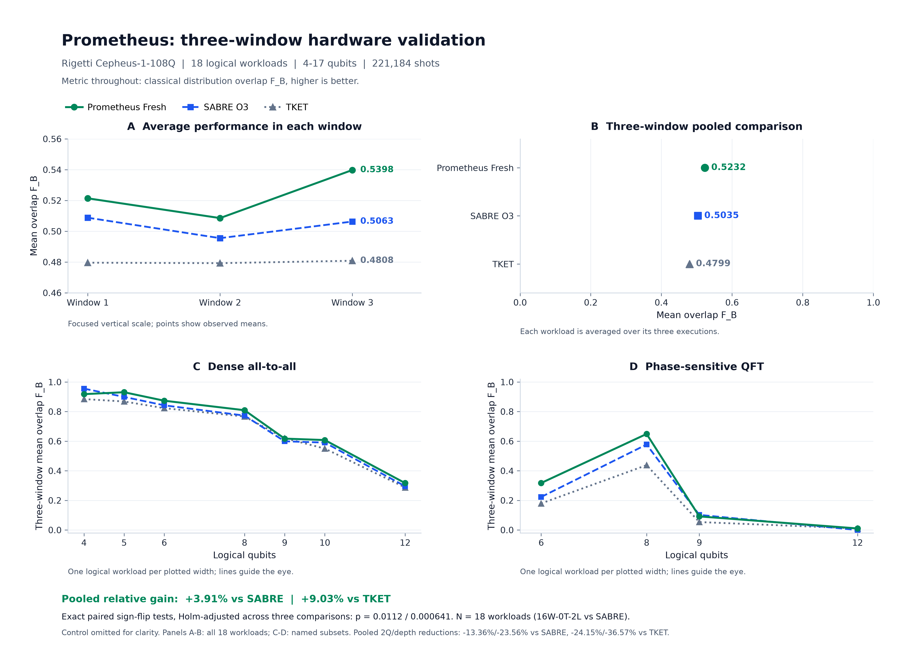

# Multi-Window Amazon Braket Validation (`108Q` Rigetti & `256`-Atom QuEra)

*Portfolio Hub: [Prometheus Quantum Overview](https://github.com/PrometheusDynamicsCanada/prometheus-quantum-overview) · [Complexity Atlas (`Cepheus-1` Star)](https://github.com/PrometheusDynamicsCanada/prometheus-circuit-complexity-atlas) · [Detailed Report](DETAILED_TECHNICAL_REPORT.md)*

**Tested across separated execution windows on Amazon Braket, Prometheus improved output fidelity on 108-qubit Rigetti superconducting hardware and exact optimal yield on 256-atom QuEra neutral-atom hardware.**

## At a Glance

- **`108Q` Rigetti `Cepheus-1` (`10` tasks, `450` circuits, `460,800` shots):** Beat SABRE O3 on **`16/18` workloads (`+3.91%` 3-window $F_B$)** and TKET on **`15/18` (`+9.03%`)**, widening its lead over SABRE to **`+6.61%`** after recalibration.
- **`256`-Atom `QuEra Aquila` (`12` AHS tasks, `3,000` Rb-87 shots across `2` windows):** Outperformed AWS's documented schedule in **both windows (`881` vs. `852` exact optima)**, cutting suboptimal MIS outcomes by **`-40.34%`** (`p = 1.1e-5`).
- **Hardest `12A` neutral-atom topology (`HP = 4.80`):** Replicated **`60.0%` (`150/250`) in both windows** vs. `50.8%` baseline (**`+18.11%` yield, `-15.35%` cost/optimum, `p = 0.0042`**).
- **Disclosed baseline wins:** SABRE led `4Q-36Q` Rigetti Clifford mirrors (`+1.31%`) and final-stage QAOA mean ratio (`+0.97%`), all published below.

*Output-distribution overlap across 18 workloads (`4Q-17Q`) on 108Q Rigetti Cepheus-1 across initial, `+9.3h` drift, and post-recalibration windows.*

---

## Executive Summary (`22` AWS Braket Tasks: `10` Rigetti `ProgramSet` + `12` QuEra `AHS`, `463,800` Shots)

*Hardware Task ARNs:* Rigetti `2a6b5957..`..`8b348409..` ([`ALL_450_RIGETTI_CIRCUITS_RESULTS.csv`](data/ALL_450_RIGETTI_CIRCUITS_RESULTS.csv)); QuEra `f95ab6..`..`88a26a..` ([`ALL_12_QUERA_AQUILA_TASKS_RESULTS.csv`](data/ALL_12_QUERA_AQUILA_TASKS_RESULTS.csv)).

| Architecture, Cohort & Strategy | Primary / Optimum `(↑)` | Overlap $F_B$ / $P_{\text{valid}}$ `(↑)` | $F_H$ / DF $P_{\text{opt}}$ `(↑)` | `HOP` / `TVD` `*(mean)*` | `CZ` / Depth `(↓)` | Outcome & Statistical Test |
| :--- | :---: | :---: | :---: | :---: | :---: | :--- |
| **Rigetti 3-Window (`216` circs): SABRE O3** | `0.5011` | `0.5035` (`0.5841` med) | `0.3519` | `0.5586` / `0.6916` | `105.4` / `194.4` | `2 / 18` vs. Prom |
| **Rigetti 3-Window (`216` circs): TKET O2** | `0.4801` | `0.4799` (`0.4941` med) | `0.3243` | `0.5309` / `0.7196` | `120.4` / `234.2` | `2 / 18` vs. Prom |
| **Rigetti 3-Window (`216` circs): Prom Fresh** | **`0.5197`** | **`0.5232` (`0.6125` med)** | **`0.3723`** | **`0.5770` / `0.6754`** | **`91.4` / `148.6`** | **`+3.91%` vs. S (`p=0.011`) · `+6.61%` W3** |
| **QuEra Pooled (`1,500` shots): AWS Base** | `852 / 1500` (`56.80%`) | `92.13%` valid IS | `58.38%` DF opt | `176` subopt MIS | `3.0 us` (`0` local) | `USD 0.01972 / opt` |
| **QuEra Pooled (`1,500` shots): Prometheus** | **`881 / 1500` (`58.73%`)** | **`92.93%` valid IS** | **`60.48%` DF opt** | **`105` subopt (`-40.3%`)** | `3.0 us` (`0` local) | **`USD 0.01907 / opt` (`12A` `-15.35%`, `p=0.0042`)** |

*Metric Key:* Rigetti $F_B = \sum_x \sqrt{P_{\text{ideal}}(x)P_{\text{meas}}(x)}$ ($F_H = F_B^2$; Shannon entropy `7.86` Prom vs. `7.88` S / `7.91` T). QuEra runs used matched `AtomArrangement`, `3.0 us` duration, and `15.7 Mrad/s` peak drive.

- **Offline raw-histogram & per-shot `pre`/`post_sequence` verifier:** `python scripts/verify_braket_campaign.py`
- **Start a supported pilot:** [william@prometheusdynamics.ca](mailto:william@prometheusdynamics.ca) | [prometheusdynamics.ca](https://prometheusdynamics.ca)

---

## Full Rigetti Pillars 1-4 & QuEra Per-Topology Tables

<strong>1. Complete Rigetti Pillars 1-4 (Window 3, Equal-CPU, QAOA, Mirrors) & QuEra Per-Instance Tables - Click to expand</strong>

### Rigetti `Cepheus-1-108Q` Supporting Pillars (`USD 198.84` Settled Across `10` Tasks)
- **Window 3 Post-Recalibration (`8e797e69..`, `72` circs):** Prom Fresh **`0.5398`** $F_B$ (`0.3880` $F_H$, `91.1 CZ / 147.7 depth`) vs. Frozen W1 `0.5251`, SABRE `0.5063` (**`+6.61%`**, `p_Holm = 0.0379`), and TKET `0.4808` (**`+12.27%`**, `p_Holm = 0.00094`).
- **Pillar 4 Unseen Equal-CPU (`5` tasks `cc7f..8b34`, `96` circs):** Prom **`0.6344`** $F_B$ (`8W-4L`) vs. Default SABRE `0.6090` (`+4.17%`, `p_Holm = 0.0337`), Equal-CPU SABRE `0.6294` (`0.6174` composite primary), and Equal-CPU TKET `0.6052`.
- **Pillar 3 QAOA Trajectories (`c9e0645b..`, `72` circs):** Prom highest top-decile cut probability (**`0.0680`** vs. `0.0656` S / `0.0652` T) & shallowest depth (**`234.8`** vs. `248.6` S / `332.8` T); SABRE led final-stage mean ratio (`0.6028` vs. `0.5970`).
- **Pillar 2 `4Q-36Q` Clifford Mirrors (`eec556a3..`, `66` circs):** Prom beat TKET by **`+16.91%`** bit accuracy (`0.6139` vs. `0.5251`, `-37.0%` `CZ`); SABRE led Prom slightly (`0.6221` vs. `0.6139`).

### QuEra `Aquila` Two-Window Neutral-Atom `MIS` Breakdown (`12` Tasks, `USD 33.60` Settled; `+84.9h` Submit Span / `+6.2h` QPU Gap on `2026-11-20`)
| Topology (`500` Shots/Arm) | Schedule | Valid IS `(↑)` | Exact Opt (`All` / `DF`) `(↑)` | Subopt MIS `(↓)` | `USD / Opt` `(↓)` & Fisher `p` |
| :--- | :--- | :---: | :---: | :---: | :--- |
| **`11A` (`HP = 3.00`)** | AWS Base / **Prom** | **`95.0%`** / `93.6%` | **`62.2%`** / `60.4%` (`63.3%` / `62.2%` DF) | `44` / **`27` (`-38.6%`)** | **`USD 0.01801`** / `0.01854` (`p = 0.60`; subopt `p = 0.048`) |
| **`12A` (`HP = 4.80`, Hardest)** | AWS Base / **Prom** | `89.4%` / **`92.4%`** | `50.8%` / **`60.0%`** (`51.6%` / **`61.2%`** DF) | `82` / **`48` (`-41.5%`)** | `USD 0.02205` / **`0.01867` (`-15.35%`, `p = 0.0042`)** |
| **`13A` (`HP = 3.33`)** | AWS Base / **Prom** | `92.0%` / **`92.8%`** | **`57.4%`** / `55.8%` (`60.2%` / `58.1%` DF) | `50` / **`30` (`-40.0%`)** | **`USD 0.01951`** / `0.02007` (`p = 0.66`; subopt `p = 0.026`) |

<strong>2. QuEra Aquila Two-Window Replication Figure - Click to expand</strong>

