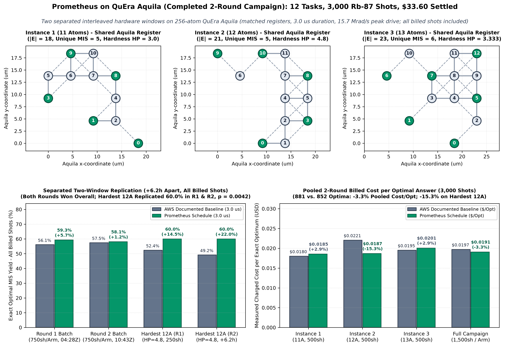

# Multi-Window Amazon Braket Validation (108Q Rigetti & 256-Atom QuEra)

*Portfolio Hub: [Prometheus Quantum Overview](https://github.com/PrometheusDynamicsCanada/prometheus-quantum-overview) · [IBM/IQM Chemistry Cost Study (52%-60% Savings)](https://github.com/PrometheusDynamicsCanada/prometheus-quantum-chemistry) · [Detailed Report](DETAILED_TECHNICAL_REPORT.md)*

Cloud quantum calibrations drift over hours, and teams using Amazon Braket work across both gate-based superconducting chips and analog neutral-atom devices. We tested whether Prometheus's execution improvements repeat across separated calibration windows on 108-qubit Rigetti Cepheus-1-108Q and on 256-atom QuEra Aquila.

On Rigetti Cepheus-1 across initial, +9.3-hour drift, and post-recalibration windows, Prometheus outperformed Qiskit SABRE O3 on 16 of 18 workloads (+3.91% three-window average output agreement, rising to +6.61% after recalibration) and Quantinuum TKET O2 on 15 of 18 (+9.03%). In a separate neutral-atom optimization study across 11-to-13-atom graph instances on 256-atom QuEra Aquila, Prometheus beat AWS's documented schedule in both windows, increasing exact optimal answers on the hardest 12-atom graph from 50.8% to 60.0% (+18.1% yield, -15.4% cost per optimum, p = 0.0042) and cutting suboptimal traps by 40.3%.

- **Industrial optimization & chemistry context:** Multi-window repeatability on superconducting and neutral-atom hardware underpins practical R&D workloads across logistics, materials, and computational chemistry. Separate small-molecule studies on IBM Fez and IQM Emerald ([`prometheus-quantum-chemistry`](https://github.com/PrometheusDynamicsCanada/prometheus-quantum-chemistry)) cut billed QPU resources per confirmed molecular-energy result by 52% to 60% (measured on IBM and IQM rather than Braket), making multi-processor chemistry evaluation on Amazon Braket a natural next step alongside the Rigetti and QuEra benchmarks archived here.
- **Measured boundaries:** On Rigetti 4-to-36-qubit Clifford mirror diagnostics SABRE led slightly (0.6221 vs. 0.6139 bit accuracy), and on easier 11-atom and 13-atom Aquila graphs exact optimum rates were statistically tied even though suboptimal traps fell by 38.6% to 40.0%.

This repository contains the circuits, raw Rb-87 atom sequences, and offline verification tools from 22 completed Amazon Braket tasks (463,800 measurement shots).

*Summary figure: Average output agreement across 18 workloads (4 to 17 qubits, 216 circuits) on 108-qubit Rigetti Cepheus-1 across three calibration windows.*

**[Read the detailed results](#detailed-results) · [Verify the data](#verify-the-data) · [Evaluate chemistry or compilation on Braket](https://prometheusdynamics.ca/connect/) · [Book a demonstration](mailto:william@prometheusdynamics.ca?subject=Prometheus%20Evaluation)**

---

## Executive Summary (`22` AWS Braket Tasks: `10` Rigetti Gate-Model + `12` `256`-Atom QuEra Analog, `463,800` Shots)

*Hardware Task ARNs:* Rigetti `2a6b5957..`..`8b348409..` ([`ALL_450_RIGETTI_CIRCUITS_RESULTS.csv`](data/ALL_450_RIGETTI_CIRCUITS_RESULTS.csv)); QuEra `f95ab6..`..`88a26a..` ([`ALL_12_QUERA_AQUILA_TASKS_RESULTS.csv`](data/ALL_12_QUERA_AQUILA_TASKS_RESULTS.csv)).

| Architecture, Cohort & Strategy | Primary / Optimum `(↑)` | Output Agreement $F_B$ / $P_{\text{valid}}$ `(↑)` | $F_H$ / DF $P_{\text{opt}}$ `(↑)` | `HOP` / `TVD` *(mean)* | `CZ` / Depth `(↓)` | Outcome & Statistical Test |
| :--- | :---: | :---: | :---: | :---: | :---: | :--- |
| **Rigetti 3-Window (`216` circs): SABRE O3** | `0.5011` | `0.5035` (`0.5841` med) | `0.3519` | `0.5586` / `0.6916` | `105.4` / `194.4` | `2 / 18` vs. Prom |
| **Rigetti 3-Window (`216` circs): TKET O2** | `0.4801` | `0.4799` (`0.4941` med) | `0.3243` | `0.5309` / `0.7196` | `120.4` / `234.2` | `2 / 18` vs. Prom |
| **Rigetti 3-Window (`216` circs): Prom Fresh** | **`0.5197`** | **`0.5232` (`0.6125` med)** | **`0.3723`** | **`0.5770` / `0.6754`** | **`91.4` / `148.6`** | **`+3.91%` vs. S (`p=0.011`) · `+6.61%` W3** |
| **QuEra `11-13` Atoms (`1,500` shots): AWS Base** | `852 / 1500` (`56.80%`) | `92.13%` valid IS | `58.38%` DF opt | `176` subopt MIS | `3.0 us` (`0` local) | `$16.80` (`1.97c / opt`) |
| **QuEra `11-13` Atoms (`1,500` shots): Prom** | **`881 / 1500` (`58.73%`)** | **`92.93%` valid IS** | **`60.48%` DF opt** | **`105` subopt (`-40.3%`)** | `3.0 us` (`0` local) | **`$16.80` (`1.91c / opt`; `12A` `-15.35%`, `p=0.0042`)** |

*Metric Key:* Rigetti output-distribution agreement is $F_B = \sum_x \sqrt{P_{\text{ideal}}(x)P_{\text{meas}}(x)}$ ($F_H = F_B^2$; Shannon entropy `7.86` Prom vs. `7.88` S / `7.91` T). QuEra runs tested `11-13`-atom registers on the `256`-atom `Aquila` device (`3.0 us` duration, `15.7 Mrad/s` peak drive, `0` local detuning terms).

---

## Inspect the Evidence & Reproduce Supported Checks Offline

- **Command:** `python scripts/verify_braket_campaign.py`
- **Dependencies & measured runtime:** Python 3 + `numpy` + `scipy` (`0` cloud credentials, **`~1.34 s`** measured runtime; reconstructs all `450` Rigetti circuits and `3,000` raw `pre`/`post_sequence` Rb-87 neutral-atom shots).
- **Request an evaluation or book a demonstration:** [prometheusdynamics.ca/connect](https://prometheusdynamics.ca/connect/) | [william@prometheusdynamics.ca](mailto:william@prometheusdynamics.ca?subject=Prometheus%20Evaluation)

---

## Full Rigetti Pillars 1-4 & QuEra Per-Topology Tables

<strong>1. Complete Rigetti Pillars 1-4 (Window 3, Equal-CPU, QAOA, Mirrors) & QuEra 11-13 Atom Tables - Click to expand</strong>

- **Window 3 Post-Recalibration (`8e797e69..`, `72` circs):** Prom Fresh **`0.5398`** $F_B$ (`0.3880` $F_H$, `91.1 CZ / 147.7 depth`) vs. Frozen W1 `0.5251`, SABRE `0.5063` (**`+6.61%`**, `p_Holm = 0.0379`), and TKET `0.4808` (**`+12.27%`**, `p_Holm = 0.00094`).
- **Pillar 4 Unseen Equal-CPU (`5` tasks `cc7f..8b34`, `96` circs):** Prom **`0.6344`** $F_B$ (`8W-4L`) vs. Default SABRE `0.6090` (`+4.17%`), Equal-CPU SABRE `0.6294`, and Equal-CPU TKET `0.6052`.
- **Pillar 3 QAOA Trajectories (`c9e0645b..`, `72` circs):** Prom highest top-decile cut probability (**`0.0680`** vs. `0.0656` S / `0.0652` T); SABRE led final-stage mean ratio (`0.6028` vs. `0.5970`).
- **Pillar 2 `4Q-36Q` Clifford Mirrors (`eec556a3..`, `66` circs):** Prom beat TKET `+16.91%` bit accuracy (`0.6139` vs. `0.5251`); SABRE led Prom slightly (`0.6221` vs. `0.6139`).

| Topology (`500` Shots/Arm, `$5.60`/Arm on `256`-Atom Aquila) | Schedule | Valid IS `(↑)` | Exact Opt (`All` / `DF`) `(↑)` | Subopt MIS `(↓)` | `Cents / Opt` `(↓)` & Fisher `p` |
| :--- | :--- | :---: | :---: | :---: | :--- |
| **`11`-Atom (`11A`, `HP = 3.00`)** | AWS Base / **Prom** | **`95.0%`** / `93.6%` | **`62.2%`** / `60.4%` (`63.3%` / `62.2%` DF) | `44` / **`27` (`-38.6%`)** | **`1.80c`** / `1.85c` (`p = 0.60`; subopt `p = 0.048`) |
| **`12`-Atom (`12A`, `HP = 4.80`, Hardest)** | AWS Base / **Prom** | `89.4%` / **`92.4%`** | `50.8%` / **`60.0%`** (`51.6%` / **`61.2%`** DF) | `82` / **`48` (`-41.5%`)** | `2.21c` / **`1.87c` (`-15.35%`, `p = 0.0042`)** |
| **`13`-Atom (`13A`, `HP = 3.33`)** | AWS Base / **Prom** | `92.0%` / **`92.8%`** | **`57.4%`** / `55.8%` (`60.2%` / `58.1%` DF) | `50` / **`30` (`-40.0%`)** | **`1.95c`** / `2.01c` (`p = 0.66`; subopt `p = 0.026`) |

<strong>2. QuEra Aquila Two-Window Neutral-Atom Replication Figure - Click to expand</strong>

